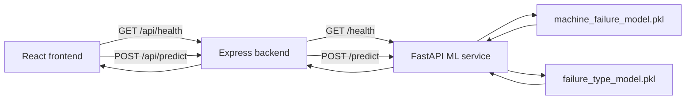

# MechSense - Project Documentation

## 1. Project Overview

MechSense is an AI-powered Industrial IoT predictive maintenance dashboard. It takes machine sensor readings, estimates the chance of failure, and identifies likely failure types when failure is predicted.

It has three components:
- **React frontend** - UI, routing, and result presentation
- **Node.js + Express backend** - input validation, routing, and communication with the ML service
- **Python + FastAPI ML service** - model loading and two-stage inference

The app runs locally. Most dashboard pages use static fixture data; only predictions and system health checks use live backend/ML communication.

## 2. System Architecture



| Component | Responsibility |
| --- | --- |
| React frontend (`frontend/`) | Routes, forms, charts, result display. Calls Express via `src/services/api.js`. |
| Express backend (`backend/`) | Validates input, enforces CORS/timeouts, maps ML errors, proxies to FastAPI. Exposes `/api/health` and `/api/predict`. |
| FastAPI ML service (`ml-service/`) | Validates with Pydantic, loads `.pkl` pipelines at startup, runs two-stage inference, exposes `/health` and `/predict`. |
| Saved models (`ml-service/models/`) | `machine_failure_model.pkl` (failure probability) and `failure_type_model.pkl` (failure types). Loaded with `joblib`; not retrained at runtime. |

## 3. Request Flow

1. `Predict.jsx` uses React Hook Form to check inputs exist.
2. `predictMachine()` in `src/services/api.js` sends JSON to `POST /api/predict`.
3. Express (`routes/predictionRoutes.js`) validates: machine type `L`/`M`/`H`, numeric ranges, `processTemp >= airTemp`, and rejects unknown fields. Returns `400` on invalid input.
4. Express (`services/mlService.js`) forwards valid data to FastAPI at `${ML_SERVICE_URL}/predict` with a 10s timeout.
5. FastAPI validates via `SensorReading` (aliases `airTemp`/`processTemp`, `extra="forbid"`, normalized type).
6. `predictor.py` builds a one-row DataFrame with expected columns (adds `Temperature Difference [K]`).
7. Stage 1 (XGBoost) returns failure probability; if `>= 0.40`, Stage 2 (Logistic Regression MultiOutputClassifier) runs.
8. FastAPI returns prediction JSON; Express passes it through; React maps via `toPredictionResult()` into result cards.

Error mapping (Express): ML unreachable → `503` (`ML_UNAVAILABLE`). ML returns `422` → `422` with details. ML returns `503` → `503`. Other ML errors → `502`. JSON parse errors → `400`. Unknown routes → `404`.

## 4. Frontend Structure

### Routes (`src/main.jsx`)

| Route | Page |
| --- | --- |
| `/` | `Landing.jsx` |
| `/dashboard` | `Dashboard.jsx` |
| `/machines` | `Machines.jsx` |
| `/machines/:id` | `MachinesDetail.jsx` |
| `/predict` | `Predict.jsx` |
| `/model-performance` | `ModelPerformance.jsx` |

`AppLayout.jsx` wraps most pages with sidebar/footer; landing page runs without sidebar.

### Key files/folders

| Path | Purpose |
| --- | --- |
| `src/services/api.js` | Only API caller. Reads `VITE_API_BASE_URL` (fallback `http://localhost:5000`). Exposes `getHealth(signal)`, `predictMachine(sensorReading)`. Converts backend validation details to readable errors. |
| `src/pages/Predict.jsx` | Holds `result`, `loading`, `error`. Uses `toPredictionResult()` (maps `failure_probability`→`probability`, `predicted_failure`→`1`/`0`, failure types→`likelyCauses`) and `riskBandFor()`. |
| `src/data/` | Static fixtures: `machines.js` (`MOCK_MACHINES`), `dashboard.js`, `modelComparison.js`, `maintenanceRules.js`, `constants.js`. Dashboard/machine/model-performance pages read from these. |
| `src/components/dashboard/`, `src/components/machines/`, `src/components/landing/` | Page-specific UI components. |

## 5. Express Backend

| File | Responsibility |
| --- | --- |
| `server.js` | Loads env via `dotenv` (quiet). Sets `PORT` (default 5000), `FRONTEND_ORIGIN` (default `http://localhost:5173`, comma-split). Enables CORS for allowed origins, JSON parsing. Mounts routes at `/api`. 404 and error handlers (JSON parse → 400, unexpected → 500). |
| `routes/predictionRoutes.js` | `GET /api/health` calls ML health; returns 200 if `status==="ok"` and `models_loaded` true, else 503 with wrapped ML health. `POST /api/predict` validates input (mirrors FastAPI rules), rejects unknown fields, returns 400 with details on failure. Maps ML errors via codes/statuses as above. |
| `services/mlService.js` | Wrapper around `fetch`. Reads `ML_SERVICE_URL` (default `http://127.0.0.1:8000`), 10s timeout via `AbortSignal.timeout`. On network failure sets `code: "ML_UNAVAILABLE"`. On non-OK sets `code: "ML_ERROR"`, attaches `status` and `details` (prefers `data.detail`). No DB layer. |

## 6. Python ML Service

| File | Responsibility |
| --- | --- |
| `app/main.py` | FastAPI app with lifespan loading both models at startup (logs errors but keeps service up). CORS for local dev origins. Routes: `GET /` (status), `GET /health` (via `get_model_status()`), `POST /predict` (checks `models_are_loaded()`, tries reload if needed, calls `predict_machine()`). |
| `app/predictor.py` | Model paths under `ml-service/models/`. Thresholds: `CLASSIFICATION_THRESHOLD=0.40`, `FAILURE_TYPE_THRESHOLD=0.50`. `FEATURE_COLUMNS` include engineered `Temperature Difference [K]`. Labels order `["TWF","HDF","PWF","OSF","RNF"]`. Loads with `joblib` once (module globals). Builds feature DataFrame, runs Stage 1 via `predict_proba()[0][1]`, runs Stage 2 only if failure predicted (`>=0.40`), collects probs above `>=0.50`, sorts types by prob desc, rounds outputs. |
| `app/schemas.py` | `SensorReading`: aliases `type`/`airTemp`/`processTemp`/`rpm`/`torque`/`toolWear`, normalizes type to uppercase, `extra="forbid"`, ranges/constraints match Express (`airTemp 250-350`, `processTemp 250-400`, `rpm>0 and <=10000`, `torque 0-1000`, `toolWear 0-2000`, `processTemp>=airTemp`). `PredictionResponse`/`HealthResponse` models. |
| `requirements.txt` | FastAPI, Uvicorn, pandas, NumPy, scikit-learn, XGBoost, joblib. |

## 7. Machine Learning Workflow

### Dataset
Based on landing page, fixture data, and project notes: **AI4I 2020 Predictive Maintenance Dataset**. Raw CSV and training notebook are not in the repo; provenance beyond this cannot be established from available files.

### Input features
| API field | Model column | Meaning |
| --- | --- | --- |
| `type` | `Type` | Machine quality type: `L`, `M`, or `H` |
| `airTemp` | `Air temperature [K]` | Air temperature |
| `processTemp` | `Process temperature [K]` | Process temperature |
| `rpm` | `Rotational speed [rpm]` | Rotational speed |
| `torque` | `Torque [Nm]` | Torque |
| `toolWear` | `Tool wear [min]` | Tool wear |
| derived | `Temperature Difference [K]` | `processTemp - airTemp` (engineered) |

### Preprocessing
Saved pipelines contain a `ColumnTransformer`: `Type` one-hot encoded; numeric columns passed through. Temperature difference is computed in `predictor.py` before passing to pipelines.

### Stage 1: XGBoost (failure classification)
- Model: XGBoost classifier in `machine_failure_model.pkl` (saved pipeline)
- Hyperparameters (from saved model): `n_estimators=300`, `max_depth=4`, `learning_rate=0.05`, `subsample=0.8`, `colsample_bytree=0.8`, `random_state=42`
- Inference: take column 1 of `predict_proba()` as failure probability
- Threshold: **>= 0.40** → `predicted_failure = true`

### Stage 2: Logistic Regression MultiOutputClassifier (failure types)
- Model: `MultiOutputClassifier` with Logistic Regression inner estimator in `failure_type_model.pkl`
- Output order (confirmed): **TWF, HDF, PWF, OSF, RNF**
- Inference: `predict_proba()` gives per-type arrays; probability for class 1 taken per type
- Threshold: include type if probability **>= 0.50**; returned in `failure_types` sorted by probability desc
- All type probabilities returned in `failure_type_probabilities` rounded to 4 decimals

### Conditional execution
Stage 2 runs only if Stage 1 predicts failure (`>=0.40`). If healthy, no failure types are computed/returned.

### Training vs inference
`.pkl` files contain fitted preprocessing and fitted models. The service only loads and runs inference. Training occurred separately; raw data/training notebook not present, so training is not reproducible from this repo.

## 8. API Documentation

### Express API

#### `GET /api/health`
Calls Python `/health`. Returns:
```json
{
  "backend": "ok",
  "mlService": {
    "status": "ok",
    "models_loaded": true,
    "failure_model_loaded": true,
    "failure_type_model_loaded": true,
    "load_error": null
  }
}
```
If Python unreachable, Express returns `503` with ML unavailable status.

#### `POST /api/predict`
Accepts: `type`, `airTemp`, `processTemp`, `rpm`, `torque`, `toolWear`. Forwards validated data to FastAPI and returns prediction JSON unchanged. Returns `400` on validation failure (with `details`), `422` if ML rejects (with details), `503` if ML unavailable/not ready, `502` otherwise.

### FastAPI API

#### `GET /health`
Returns: `status`, `models_loaded`, `failure_model_loaded`, `failure_type_model_loaded`, `load_error`.

#### `POST /predict`
**Request:**
```json
{
  "type": "L",
  "airTemp": 302.0,
  "processTemp": 310.8,
  "rpm": 1383,
  "torque": 50.3,
  "toolWear": 231
}
```

**Response fields:**
| Field | Type | Meaning |
| --- | --- | --- |
| `failure_probability` | number | Stage 1 failure probability (0-1), rounded to 4 decimals |
| `predicted_failure` | boolean | `true` if probability >= threshold |
| `threshold` | number | Failure threshold used (`0.4`) |
| `temperature_difference` | number | `processTemp - airTemp`, rounded to 2 decimals |
| `failure_types` | string[] | Failure types with prob >= 0.50, sorted by prob desc |
| `failure_type_probabilities` | object | Probabilities for TWF/HDF/PWF/OSF/RNF, rounded to 4 decimals |

See README for a complete example.

## 9. Environment Configuration

| Location | Variables | Notes |
| --- | --- | --- |
| `frontend/.env` | `VITE_API_BASE_URL=http://localhost:5000` | Used by `src/services/api.js`; falls back to `http://localhost:5000` if missing. |
| `backend/.env` | `PORT=5000`, `ML_SERVICE_URL=http://127.0.0.1:8000`, `FRONTEND_ORIGIN=http://localhost:5173` | `PORT` for Express. `ML_SERVICE_URL` for FastAPI. `FRONTEND_ORIGIN` allowed CORS origin(s), comma-separated. |
| `ml-service/` | None required | Uses local model paths from `app/predictor.py`. No `.env`/`.env.example` present. |
| `frontend/.env.example`, `backend/.env.example` | Same values as above | Tracked; real `.env` files ignored by git. |

## 10. Running the Application

Run from the `MechSense` project root in three terminals.

**Terminal 1 - ML service (port 8000):**
```powershell
cd ml-service
.\venv\Scripts\Activate.ps1
uvicorn app.main:app --reload
```
```bash
cd ml-service
source venv/bin/activate
uvicorn app.main:app --reload
```

**Terminal 2 - Express backend (port 5000):**
```powershell
cd backend
npm run dev
```

**Terminal 3 - React frontend (port 5173):**
```powershell
cd frontend
npm run dev
```

Open `http://localhost:5173`. Sidebar status reflects Express and ML model availability.

## 11. Limitations

- No database (MongoDB not connected); no prediction history/storage.
- Dashboard, machines, and model-performance pages use static fixtures (`src/data/*`); machine list has 30 sample records.
- Model performance metrics are frontend fixture data, not calculated live.
- No authentication/authorization or deployment configuration.
- Designed for local development only.
- Maintenance recommendation rules are simulated project rules, not validated industrial limits.
- Raw dataset and training notebook missing; training not reproducible from repo.
- No automated tests.

## 12. Future Scope

- Add MongoDB for machine records, prediction history, and audit data.
- Replace static fixtures with DB-backed API data.
- Add live sensor ingestion.
- Add authentication and role-based access.
- Add Docker/deployment support.
- Add API and ML service tests.
- Add model versioning and reproducible training pipeline.
- Generate model-performance page from saved evaluation results.
- Add feature importance/SHAP explanations.
- Validate maintenance rules against real machine data.
