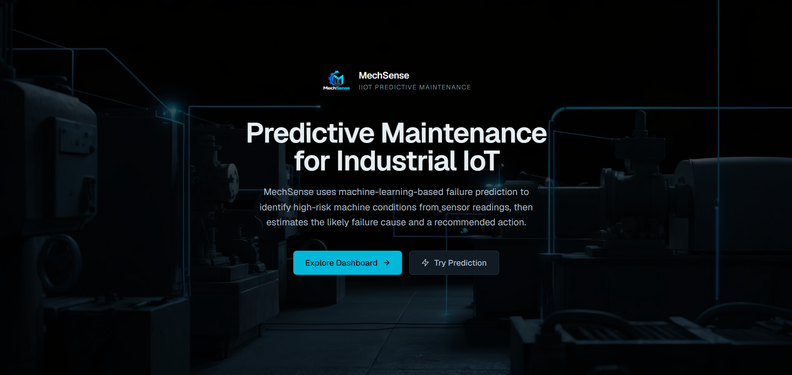
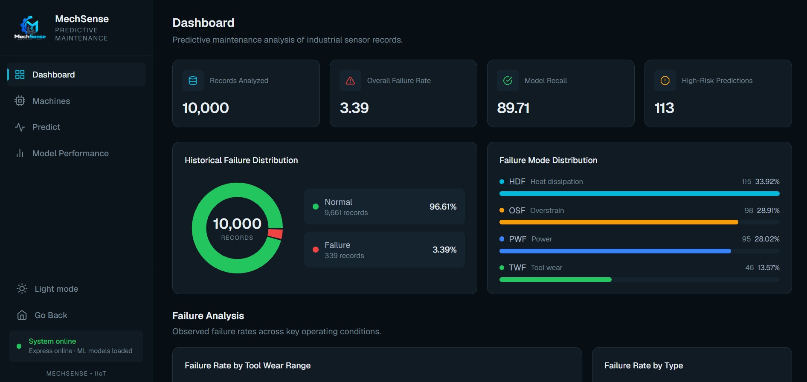
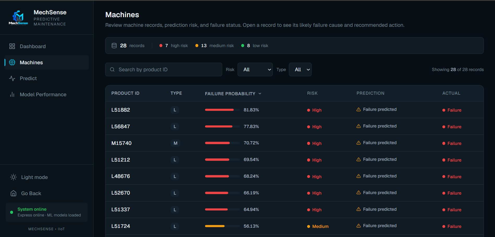
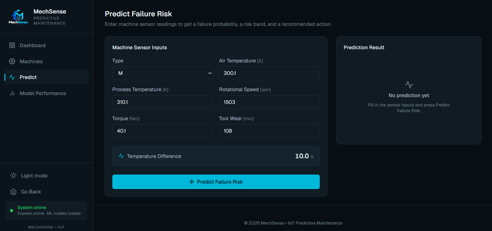
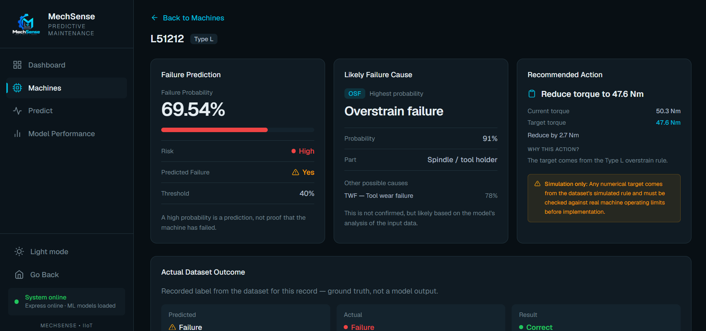
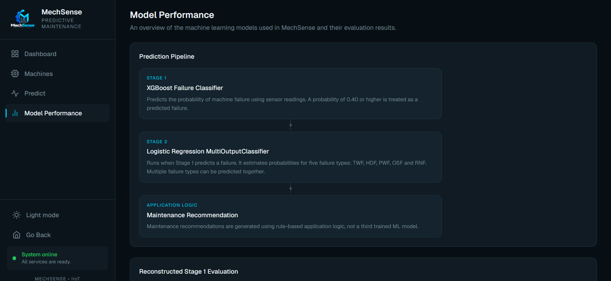

# MechSense – AI-Powered Industrial IoT Predictive Maintenance Dashboard

MechSense is a college project that estimates machine failure risk from industrial sensor readings. It has a React dashboard, an Express API, and a Python machine-learning service.

## Live Demo

[Open MechSense](https://mechsense-predict.vercel.app)

The frontend is deployed on Vercel. The backend and ML service are deployed on Render.

## 1. About the Project

Predictive maintenance means using machine data to find problems before a breakdown happens. Instead of waiting for a machine to fail, maintenance can be planned earlier.

MechSense takes six inputs: machine type, air temperature, process temperature, rotational speed, torque, and tool wear. Two trained models then work in steps:

1. **Stage 1** estimates the probability that the machine will fail.
2. **Stage 2** runs only if a failure is predicted. It tells which failure types are likely.

The app also shows a simple rule-based maintenance recommendation.

It shows the full flow from a React form to a Python ML model. This is a college project, not a production system.

## 2. Features

- **Landing page** – explains the project, dataset, model approach, and the two-stage design.
- **Dashboard** – KPI cards, failure distribution, failure-rate charts, risk bands, and a torque/RPM scatter plot. All numbers come from the ML service.
- **Machines** – table of all 10,000 records with search, type and risk filters, sorting by failure probability, and pagination.
- **Machine Details** – one record with the model prediction, risk band, likely causes, recommended action, the actual outcome from the dataset, sensor readings, and a comparison with historical averages.
- **Predict** – enter sensor values and get the failure probability, risk band, failure types, and a maintenance recommendation.
- **Model Performance** – the two-stage pipeline, Stage 1 metrics, and confusion matrix.
- **System status** – the sidebar checks whether Express and the ML service are running.
- **Dark / light theme** toggle.

### What is live and what is fixed

| Page                                                                       | Data source                                            |
| -------------------------------------------------------------------------- | ------------------------------------------------------ |
| Dashboard, Machines, Machine Details, Predict, System status               | Live: Express → ML service                             |
| Landing page numbers (records and failure rate)                           | Live: `/api/dashboard`; model metrics remain fixed in `frontend/src/data/modelComparison.js` |
| Model Performance page                                                     | Fixed values in `frontend/src/data/modelComparison.js` |
| "Sensor vs Historical Average" on Machine Details                          | Live: `/api/dashboard`                                 |

The dashboard API reuses the cached enriched dataset and model predictions.

## Screenshots

### Landing



### Dashboard



### Machines



### Prediction



### Machine Details



### Model Performance



## 3. Tech Stack

**Frontend:** React 19, Vite 8, Tailwind CSS 4, React Router, React Hook Form, Recharts, Motion, React Icons.

**Backend:** Node.js, Express 5, CORS, dotenv.

**Machine Learning:** Python, FastAPI, Uvicorn, XGBoost, scikit-learn, pandas, NumPy, joblib.

There is no database in the current version.

## 4. How It Works

```text
React frontend -> Express backend -> FastAPI ML service -> saved models + AI4I dataset
```

**Prediction**

1. React collects the sensor readings.
2. Express validates them and forwards them to Python.
3. FastAPI validates them again and builds the feature row (adding the temperature difference).
4. The Stage 1 model returns the failure probability.
5. If the probability is 0.40 or more, the Stage 2 model returns the likely failure types.
6. The result goes back through Express to React.

**Dashboard and machine data**

1. When FastAPI starts, it reads `ml-service/data/ai4i2020.csv` and runs both models on all 10,000 records.
2. The results are kept in memory (no database).
3. React calls `/api/dashboard`, `/api/machines`, or `/api/machines/:udi`.
4. Express checks the query parameters and passes the request to FastAPI.
5. FastAPI returns the dashboard totals, one page of machines, or one machine.

## 5. Machine Learning

**Dataset:** AI4I 2020 Predictive Maintenance Dataset, 10,000 records, 339 failures (3.39%). The CSV is in `ml-service/data/ai4i2020.csv`. The training notebook is not included.

### Stage 1 – Failure probability

- Model: XGBoost classifier.
- Input: machine type, the five sensor readings, and one extra feature: temperature difference (process temperature − air temperature).
- Output: a probability from 0 to 1.
- Threshold: **0.40**. A probability of 0.40 or more means "predicted to fail". A lower threshold than 0.50 is used to catch more real failures.

### Stage 2 – Failure types

- Model: Logistic Regression inside a scikit-learn `MultiOutputClassifier`.
- Runs only when Stage 1 predicts a failure.
- Output: one probability for each type. A type is reported if its probability is **0.50** or more.
- Types: `TWF` tool wear, `HDF` heat dissipation, `PWF` power, `OSF` overstrain, `RNF` random.

### Results (Stage 1, 20% test split, threshold 0.40)

| Metric    | Value  |
| --------- | ------ |
| Accuracy  | 97.05% |
| Precision | 53.98% |
| Recall    | 89.71% |
| F1-score  | 67.40% |
| ROC-AUC   | 97.80% |

Confusion matrix: 1880 true negatives, 52 false positives, 7 false negatives, 61 true positives.

These numbers are recorded from a stratified 80/20 split with `random_state=42`. The training notebook is not included, so the evaluation cannot be reproduced from this repository alone. Recall is high (most real failures are caught), but precision is lower (some false alarms). This is the trade-off of using a 0.40 threshold.

### Important note about the Dashboard and Machines pages

These pages run the model on all 10,000 records. About 80% of them were also used for training, so the "Correct / Missed" outcome on Machine Details looks better than it would on new data. The **Model Performance** page is the fair measurement because it uses only the 20% test split.

## 6. Project Structure

```text
MechSense/
├── backend/
│   ├── routes/predictionRoutes.js
│   ├── services/mlService.js
│   ├── server.js
│   ├── package.json
│   └── .env.example
├── frontend/
│   ├── src/
│   │   ├── components/
│   │   ├── context/
│   │   ├── data/
│   │   ├── layouts/
│   │   ├── pages/
│   │   ├── services/api.js
│   │   └── main.jsx
│   ├── package.json
│   └── .env.example
├── ml-service/
│   ├── app/
│   │   ├── main.py
│   │   ├── predictor.py
│   │   └── schemas.py
│   ├── data/ai4i2020.csv
│   ├── models/
│   │   ├── machine_failure_model.pkl
│   │   └── failure_type_model.pkl
│   └── requirements.txt
├── docs/screenshots/
├── README.md
└── PROJECT.md
```

## 7. Setup and Installation

### Prerequisites

- Node.js and npm (a recent LTS version that supports Vite 8).
- Python 3.10 or newer.
- Git.

### Frontend

```powershell
cd frontend
npm install
Copy-Item .env.example .env
```

### Backend

```powershell
cd backend
npm install
Copy-Item .env.example .env
```

### ML service

Windows PowerShell:

```powershell
cd ml-service
python -m venv venv
.\venv\Scripts\Activate.ps1
python -m pip install -r requirements.txt
```

macOS or Linux:

```bash
cd ml-service
python3 -m venv venv
source venv/bin/activate
python -m pip install -r requirements.txt
```

The ML service does not need an `.env` file.

## 8. Running the Project

Run each service in its own terminal.

**Terminal 1 – ML service**

```powershell
cd ml-service
.\venv\Scripts\Activate.ps1
uvicorn app.main:app --reload
```

**Terminal 2 – Express backend**

```powershell
cd backend
npm run dev
```

**Terminal 3 – React frontend**

```powershell
cd frontend
npm run dev
```

| Service            | URL                                     |
| ------------------ | --------------------------------------- |
| React frontend     | http://localhost:5173                   |
| Express backend    | http://localhost:5000                   |
| FastAPI ML service | http://localhost:8000 (docs at `/docs`) |

Start the ML service first. It takes a few seconds at startup because it runs the models on the whole dataset.

## 9. API Endpoints (Express)

| Method | Endpoint             | Purpose                                         |
| ------ | -------------------- | ----------------------------------------------- |
| GET    | `/api/health`        | Checks Express and the ML service               |
| POST   | `/api/predict`       | Predicts failure for one set of sensor readings |
| GET    | `/api/dashboard`     | Totals and chart data for the dashboard         |
| GET    | `/api/machines`      | Paginated machine list                          |
| GET    | `/api/machines/:udi` | One machine by its dataset ID (UDI)             |

`/api/machines` accepts these query parameters: `page`, `limit` (max 100, default 50), `search` (product ID or UDI), `type` (L, M, H), `risk` (Low, Medium, High), and `sort` (asc or desc, by failure probability).

### `POST /api/predict`

Request:

```json
{
  "type": "L",
  "airTemp": 302.0,
  "processTemp": 310.8,
  "rpm": 1383,
  "torque": 50.3,
  "toolWear": 231
}
```

Response (from the saved models):

```json
{
  "failure_probability": 0.9837,
  "predicted_failure": true,
  "threshold": 0.4,
  "temperature_difference": 8.8,
  "failure_types": ["OSF", "TWF"],
  "failure_type_probabilities": {
    "TWF": 0.648,
    "HDF": 0.1364,
    "PWF": 0.0,
    "OSF": 0.998,
    "RNF": 0.0773
  }
}
```

Invalid input returns HTTP `400` with an `error` message and a `details` list.

### `GET /api/health`

```json
{
  "backend": "ok",
  "mlService": {
    "status": "ok",
    "models_loaded": true,
    "failure_model_loaded": true,
    "failure_type_model_loaded": true,
    "load_error": null,
    "dataset_loaded": true,
    "dataset_records": 10000,
    "dataset_error": null
  }
}
```

## 10. Current Limitations

- No database. Predictions are not saved.
- The app uses 10,000 historical records, not live machine data.
- The training notebook is not included, so training cannot be repeated from this repository.
- Dashboard and Machines pages run the model on records that were partly used for training (see the note in section 5).
- Model Performance metrics are fixed evaluation results; landing statistics and historical sensor averages are calculated from the cached dashboard data.
- Maintenance recommendations use the simulated rules of the AI4I dataset, not real industrial safety limits.
- There is no login.
- There are no automated tests.

## 11. Future Improvements

These are ideas, not current features:

- Save prediction history in MongoDB.
- Add login and user roles.
- Add automated tests for the API and ML service.
- Include the training notebook so training can be repeated.
- Show feature importance or SHAP explanations.
- Validate the maintenance rules with real machine data.
- Read live sensor data instead of manual input.
